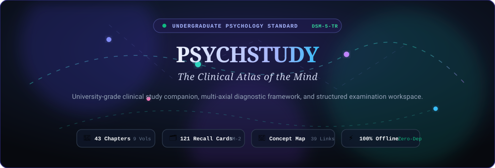
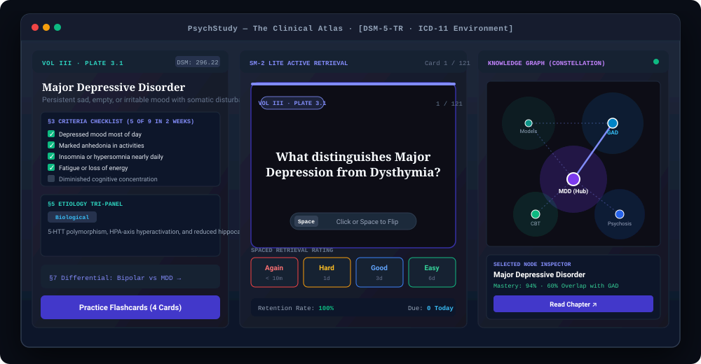

<div align="center">

  <!-- Bioluminescent Synaptic Banner (Animated Vector Graphic) -->
  <a href="https://chillingbing648-sketch.github.io/PsychStudy/">
    
  </a>

  <br/><br/>

  <!-- Blended Brand Identity & Academic Emblem -->
  <a href="https://chillingbing648-sketch.github.io/PsychStudy/">
    
  </a>

  <h1 align="center" style="font-size: 2.4rem; font-weight: 800; letter-spacing: -0.04em; margin-top: 12px;">
    PSYCHSTUDY · THE CLINICAL ATLAS
  </h1>

  <p align="center" style="font-size: 1.15rem; color: #64748B; max-width: 780px; line-height: 1.6;">
    <strong>An Undergraduate Psychology Standard Study Companion, Multi-Axial Diagnostic Framework &amp; Clinical Revision Suite</strong>
    <br/>
    <em>Rigorously aligned with the APA DSM-5-TR (2022) &amp; WHO ICD-11 (2023) Classification Systems</em>
  </p>

  <!-- Live Deployment & Core Badges -->
  <p align="center">
    <a href="https://chillingbing648-sketch.github.io/PsychStudy/"></a>
    <a href="https://github.com/chillingbing648-sketch/PsychStudy/actions"></a>
    <a href="https://github.com/chillingbing648-sketch/PsychStudy"></a>
    <a href="https://github.com/chillingbing648-sketch/PsychStudy"></a>
  </p>

  <!-- Navigation Anchors -->
  <p align="center">
    <a href="https://chillingbing648-sketch.github.io/PsychStudy/"><strong>🚀 Launch Live Web Atlas</strong></a>
    &nbsp;•&nbsp;
    <a href="#-interactive-workstation-preview">Studio Preview</a>
    &nbsp;•&nbsp;
    <a href="#-architectural-blueprint">Architecture</a>
    &nbsp;•&nbsp;
    <a href="#-six-clinical-learning-engines">Core Engines</a>
    &nbsp;•&nbsp;
    <a href="#-curriculum-topology--the-9-clinical-volumes">The 9 Volumes</a>
    &nbsp;•&nbsp;
    <a href="#-repository-structure">File Structure</a>
    &nbsp;•&nbsp;
    <a href="#-getting-started--offline-execution">Run Offline</a>
  </p>

</div>

---

## 🏛️ Executive Summary

**PsychStudy ("The Clinical Atlas")** is a university-standard clinical psychology study environment, diagnostic framework, and revision suite engineered for psychological sciences undergraduates, clinical postgraduates, and psychiatric residents.

Traditional revision suites rely on isolated, static flashcards that foster rote memorization without contextual depth. **The Clinical Atlas** re-imagines psychopathology study as a **topological knowledge graph** aligned rigorously with the **American Psychiatric Association DSM-5-TR** and the **World Health Organization ICD-11**.

Designed from the ground up as a zero-dependency vanilla single-page application (HTML5, CSS3, ES6+), it executes instantly in modern browsers and operates **100% offline via local file storage (`file:///`)**, preserving uncompromising performance, privacy, and clinical focus.

> **Lead Architect & Author:** Harsh Dubey  
> **Diagnostic Alignment:** APA DSM-5-TR (2022) & WHO ICD-11 (2023)  
> **Standard:** University Undergraduate & Postgraduate Clinical Standard  
> **Engine Architecture:** Zero npm runtime dependencies · High-performance vanilla single-page architecture  

---

## 🖥️ Interactive Workstation Preview

The Clinical Atlas provides an integrated multi-column workspace featuring an editorial academic reader, a 3D index-card active recall deck, a celestial constellation concept map, and an interactive neuroanatomy visual plate:

<div align="center">
  
</div>

---

## 🛠️ Technology Stack & Standards Wall

```
┌────────────────────────────────────────────────────────────────────────────────────────┐
│                                   CORE TECH STACK                                      │
└────────────────────────────────────────────────────────────────────────────────────────┘
```

| Domain | Technologies & Standards | Implementation Description |
| :--- | :--- | :--- |
| **Markup & Semantic Structure** | `HTML5 Semantics` · `ARIA 1.2` · `SVG 2.0` | Accessible document structure with zero bundler requirements and native SVG vectors. |
| **Styling & Design System** | `CSS3 Custom Properties` · `Subgrid` · `CSS 3D Preserves` | Luminous Day & Nocturnal Imaging Suite palettes with 9 clinical domain stains. |
| **Logic & State Engine** | `Vanilla ES6+` · `Deterministic State Store` | Centralized state engine managing curriculum routing, search, and spaced retrieval. |
| **Spaced Repetition Algorithm** | `SM-2-Lite Retrieval Engine` | Explainable interval scheduling (`<10m`, `1d`, `3d`, `6d`) with local persistence. |
| **Typography Scale** | `Fraunces` · `Newsreader` · `Instrument Sans` · `JetBrains Mono` | Editorial display, academic reading prose, UI navigation, and DSM/ICD metrics. |
| **Assessment Engine** | `Cloze Normalization` · `Differential MCQ Matrix` | Levenshtein alias evaluation, diagnostic rationales, and automated exam rubrics. |
| **Persistence & Privacy** | `HTML5 Web Storage (localStorage)` | 100% local persistence for reading progress, criteria checks, notes, and quiz history. |
| **Quality & CI/CD** | `Node.js Validation Harness` · `GitHub Actions Pages` | Automated schema validation (`tools/validate-data.mjs`) and dual-branch deployment. |

<p align="center">
  
  
  
  
  
  
  
  
  
</p>

---

## 🏗️ Architectural Blueprint

The Clinical Atlas is structured into three clean, decoupled layers operating strictly within browser-native capabilities:

```
┌─────────────────────────────────────────────────────────────────────────────────────────────┐
│                                    PRESENTATION LAYER                                       │
│   • Luminous Porcelain Canvas (Day)          • Nocturnal Imaging Workstation (Night)        │
│   • 3-Column Academic Article Reader         • 3D Ruled Index-Card Recall Workspace         │
│   • Topological Constellation Graph (SVG)    • Interactive Neuroanatomy Plate Vitrine       │
│   • Command Palette Modal (⌘K / Ctrl+K)      • Mobile Touch-First Bottom Dock Layout        │
└──────────────────────────────────────────────┬──────────────────────────────────────────────┘
                                               │ DOM Events & User Interactions
                                               ▼
┌─────────────────────────────────────────────────────────────────────────────────────────────┐
│                              CLINICAL LOGIC CONTROLLERS                                     │
│   • Router Engine (SPA Page Switching & Scroll Memory)                                      │
│   • SM-2-Lite Spaced Retrieval Scheduler (Intervals, Requeuing & Mastery Calculation)       │
│   • Diagnostic Assessment Engine (Cloze Alias Evaluator & Case Vignette Rationale)          │
│   • Live Examination Writing Coach (Word-Count Monitor & Scoring Rubrics)                   │
│   • Lexicon Contextual Popover Engine (Bidirectional Clinical Cross-Linking)                │
└──────────────────────────────────────────────┬──────────────────────────────────────────────┘
                                               │ Read & Write Operations
                                               ▼
┌─────────────────────────────────────────────────────────────────────────────────────────────┐
│                                 DATA STORE & PERSISTENCE                                    │
│   • 17 Validated ESM Modules: 43 Chapters · 121 Flashcards · 60 Quiz Items · 168 Glossary   │
│   • Browser LocalStorage: psychstudy_progress · psychstudy_fc_reviews · psa_notes           │
│   • JSON Import / Export Pipeline: Standalone encrypted data backup & restoration           │
└─────────────────────────────────────────────────────────────────────────────────────────────┘
```

---

## 🔬 Six Clinical Learning Engines

<table>
  <tr>
    <td width="50%" valign="top">
      <h3>1. 📖 The 3-Column Academic Reader</h3>
      <p>A distraction-free, 12-section standardized clinical reader engineered with Newsreader and Fraunces typography for deep absorption.</p>
      <ul>
        <li><strong>§1–§3:</strong> Operationalized Criteria &amp; Interactive Checklists</li>
        <li><strong>§4–§6:</strong> Prevalence, Biopsychosocial Tri-Panel &amp; Neurobiology</li>
        <li><strong>§7–§9:</strong> Differential Diagnosis Matrices &amp; Cultural Idioms</li>
        <li><strong>§10–§12:</strong> Case Vignettes, Examination Hub &amp; APA-7 Refs</li>
        <li><strong>Dual Modes:</strong> Deep Comprehensive, Quick Criteria, and Exam Outline.</li>
      </ul>
    </td>
    <td width="50%" valign="top">
      <h3>2. 🗂️ Active Recall &amp; Spaced Retrieval</h3>
      <p>A high-yield 3D index card workspace powered by an explainable, deterministic <strong>SM-2-lite algorithm</strong>.</p>
      <ul>
        <li><strong>121 Curated Clinical Cards:</strong> Spanning all 43 curriculum chapters.</li>
        <li><strong>Explainable Interval Scheduling:</strong> <code>Again (&lt;10m)</code>, <code>Hard (1d)</code>, <code>Good (3d)</code>, <code>Easy (6d)</code>.</li>
        <li><strong>Tactile Ergonomics:</strong> Full keyboard shortcut control (<code>Space</code> to flip, <code>1–4</code> to rate, <code>U</code> to undo).</li>
        <li><strong>Mobile Touch Optimization:</strong> Large 2×2 thumb rating grid with tactile color feedback.</li>
      </ul>
    </td>
  </tr>
  <tr>
    <td width="50%" valign="top">
      <h3>3. 🌌 Concept Map ("Constellation")</h3>
      <p>An interactive topological knowledge graph displaying comorbidity networks and differential boundaries.</p>
      <ul>
        <li><strong>43 Nodes across 9 Volume Nebulae:</strong> Visualizing spatial clusters.</li>
        <li><strong>39 Comorbidity &amp; Differential Vectors:</strong> Delicate hairline links that illuminate into radiant domain stains upon selection.</li>
        <li><strong>Progressive Disclosure:</strong> Eliminates clutter by highlighting anchor hubs and direct 1-hop neighbours on hover.</li>
        <li><strong>Clinical Inspector:</strong> Slide-up bottom sheet on mobile with instant chapter routing.</li>
      </ul>
    </td>
    <td width="50%" valign="top">
      <h3>4. ⚡ Diagnostic Assessment &amp; Quiz Suite</h3>
      <p>A rigorous evaluation engine combining canonical cloze retrieval and case vignette differential diagnosis.</p>
      <ul>
        <li><strong>1-Click Launchpad Presets:</strong> <code>Rapid 10</code>, <code>Standard 20</code>, <code>Timed Exam (15m)</code>, and <code>Weak Spots</code>.</li>
        <li><strong>Section A (Cloze):</strong> Precision DSM/ICD criterion input with normalized alias grading and examiner clue drawers.</li>
        <li><strong>Section B (Differential MCQs):</strong> Case analysis with instantaneous rationale and rule-in / rule-out justifications.</li>
        <li><strong>Persistent HUD:</strong> Sticky question jump navigation bar.</li>
      </ul>
    </td>
  </tr>
  <tr>
    <td width="50%" valign="top">
      <h3>5. 🎓 University Examination Suite</h3>
      <p>Formal university exam simulator aligned with the official Psychology of Adjustment curriculum syllabus.</p>
      <ul>
        <li><strong>Standardized Papers A &amp; B:</strong> 30 marks each with section timings.</li>
        <li><strong>Question Bank:</strong> 16 long-answer prompts with comprehensive model answers, marking rubrics, and diagnostic distinctions.</li>
        <li><strong>Live Writing Coach:</strong> Real-time word-count monitor, interval countdown timer, and self-rubric evaluation.</li>
        <li><strong>Print Ready:</strong> Formatted for standard university A4 printouts.</li>
      </ul>
    </td>
    <td width="50%" valign="top">
      <h3>6. 🧠 Interactive Neuroanatomy Atlas</h3>
      <p>Functional neuroanatomical plate illustrating neural circuits and cortico-limbic alterations in psychopathology.</p>
      <ul>
        <li><strong>6 Anatomical Divisions:</strong> Frontal, Temporal, Parietal, Occipital, Cerebellar, and Limbic Networks.</li>
        <li><strong>Pathological Correlates:</strong> Cortico-striatal dysregulation, amygdalo-hippocampal overdrive, and HPA axis hyperactivation.</li>
        <li><strong>Bilingual Cross-Referencing:</strong> Interlinks directly with the 3-Column Reader (§6 Neurobiology).</li>
      </ul>
    </td>
  </tr>
</table>

---

## 📚 Curriculum Topology · The 9 Clinical Volumes

The curriculum incorporates **43 comprehensively researched chapters** mapped across **9 Domain Stains**:

| Volume | Domain Name | Palette Stain | Key Diagnostic Chapters Covered | Standards Covered |
| :---: | :--- | :---: | :--- | :---: |
| **I** | **Foundations of Abnormality** | `teal` (`#0D9488`) | Historical Models, Four Ds, Biological &amp; Psychological Models, Stigma | DSM-5-TR §I |
| **II** | **Anxiety &amp; Trauma Disorders** | `sky` (`#0284C7`) | GAD, Panic Disorder, Agoraphobia, Specific Phobias, OCD, PTSD | F40–F43 · 6B00 |
| **III** | **Mood &amp; Affective Disorders** | `violet` (`#7C3AED`) | MDD, Persistent Depressive (Dysthymia), Bipolar I &amp; II, Cyclothymia, SAD, Suicide Risk | F30–F39 · 6A60 |
| **IV** | **Eating &amp; Body Image** | `rose` (`#E11D48`) | Anorexia Nervosa, Bulimia Nervosa, Binge-Eating Disorder | F50 · 6B80 |
| **V** | **Personality Disorders** | `purple` (`#9333EA`) | Cluster A (Eccentric), Cluster B (Borderline, Antisocial), Cluster C (Anxious) | F60 · 6D10 |
| **VI** | **Psychotic Spectrum** | `blue` (`#2563EB`) | Schizophrenia (Positive &amp; Negative), Schizoaffective, Delusional Disorder | F20–F29 · 6A20 |
| **VII** | **Clinical Therapies** | `emerald` (`#10B981`) | CBT, REBT, Systematic Desensitization, Psychodynamic, Person-Centered, Biomedical | Evidence-Based |
| **VIII** | **Culture &amp; Health Context** | `amber` (`#D97706`) | Cultural Formulation, India/South Asian Clinical Lens, Gendered Help-Seeking | APA CFI |
| **IX** | **Stress, Adjustment &amp; Coping** | `forest` (`#059669`) | Selye's GAS, Lazarus Cognitive Appraisal, Defense Mechanisms, Coping Strategies | Blueprint C &amp; D |

---

## 📁 Repository Structure

```
PsychStudy/
├── .github/
│   └── workflows/
│       └── deploy.yml              # Automated validation & GitHub Pages deployment pipeline
├── assets/
│   ├── brain-anatomy.jpg          # Neuroanatomy lateral hemisphere plate
│   ├── favicon.png                # High-res Minimal White Brain Sprout icon
│   ├── hero-brain-head.png        # Rorschach synaptic backdrop
│   ├── logo.png                   # Primary PsychStudy brand emblem
│   ├── platform-preview.svg       # Studio Workstation SVG interactive preview
│   └── readme-hero.svg            # Animated bioluminescent synaptic header banner
├── data/
│   ├── brain.js                   # 6 Neuroanatomical divisions & neural pathways
│   ├── cards.js                   # 121 Spaced retrieval clinical flashcards
│   ├── exam.js                    # 16 Long-form exam prompts, rubrics & model answers
│   ├── facts.js                   # 42 Daily clinical facts & empirical insights
│   ├── glossary.js                # 168 Psychiatric & diagnostic terms
│   ├── kb-1-foundations.js        # Vol I: Foundations of Abnormality (Chapters 1–4)
│   ├── kb-2-anxiety.js            # Vol II: Anxiety & Trauma Spectrum (Chapters 5–10)
│   ├── kb-3-mood.js               # Vol III: Mood & Affective Disorders (Chapters 11–16)
│   ├── kb-4-eating.js             # Vol IV: Eating & Body Image Disorders (Chapters 17–19)
│   ├── kb-5-personality.js       # Vol V: Personality Disorders Clusters A-C (Chapters 20–23)
│   ├── kb-6-psychotic.js          # Vol VI: Schizophrenia & Psychotic Spectrum (Chapters 24–27)
│   ├── kb-7-therapies.js          # Vol VII: Evidence-Based Clinical Therapies (Chapters 28–34)
│   ├── kb-8-culture.js            # Vol VIII: Culture, Stigma & Global Health (Chapters 35–38)
│   ├── kb-9-adjustment.js         # Vol IX: Stress, Adjustment & Coping (Chapters 39–43)
│   ├── quiz.js                    # 60 Diagnostic assessment questions (Cloze & MCQ)
│   ├── refs.js                    # 47 APA-7 academic citations & registries
│   └── timeline.js                # 25 Historical psychiatric milestones (1800–2024)
├── tools/
│   └── validate-data.mjs          # Standalone Node.js curriculum schema validator
├── AGENTS.md                      # AI agent protocol, architecture boundaries & guidelines
├── index.html                     # Offline single-page application core structure
├── script.js                      # Centralized application logic, SM-2, routing & controllers
├── style.css                      # Hospital-grade design system, tokens & mobile breakpoints
└── README.md                      # Premium repository documentation
```

---

## 🚀 Getting Started & Offline Execution

### Option 1: Live Interactive Platform
Access the production application directly in your web browser:
👉 **[https://chillingbing648-sketch.github.io/PsychStudy/](https://chillingbing648-sketch.github.io/PsychStudy/)**

### Option 2: 100% Offline Local Execution
PsychStudy has **zero dependencies** and requires no build tools or servers:

```bash
# 1. Clone the repository
git clone https://github.com/chillingbing648-sketch/PsychStudy.git

# 2. Enter project directory
cd PsychStudy

# 3. Double-click index.html or open via terminal:
# macOS:
open index.html

# Windows:
start index.html

# Linux:
xdg-open index.html
```

### Automated Data & Schema Verification
Verify all 17 clinical modules, cloze aliases, and exam coverage:

```bash
node tools/validate-data.mjs
```

```
=======================================================
   The Clinical Atlas — Data Integrity Validator
=======================================================
  ✔ Verified 47 APA-7 references registered.
  ✔ Found 43 total chapters loaded across 9 volumes.
  ✔ Verified 121 active recall cards across 39 decks.
  ✔ 60 Quiz items verified (25 canonical cloze, 35 MCQs).
  ✔ PDF Cloze Blueprint: 25 of 25 items represented (100%).
  ✔ 6 brain anatomical divisions defined.
  ✔ Daily Clinical Facts: 42 verified.
=======================================================
Errors: 0 · Warnings: 0 · [PASSED]
```

---

## 📖 Citation & Academic Attribution

If you utilize PsychStudy for university research, curriculum preparation, or examination revision, please cite:

```bibtex
@misc{dubey2026psychstudy,
  author       = {Harsh Dubey},
  title        = {PsychStudy: The Clinical Atlas of the Mind},
  year         = {2026},
  publisher    = {GitHub},
  howpublished = {\url{https://github.com/chillingbing648-sketch/PsychStudy}},
  note         = {Undergraduate Psychology Standard Aligned with DSM-5-TR and ICD-11}
}
```

---

## ⚖️ Academic Notice & Peer Disclaimer

**PsychStudy ("The Clinical Atlas")** is an independent, non-commercial university revision and psychological sciences study environment. It is engineered strictly for educational, scientific, and examination revision purposes. It does not provide medical advice, psychiatric diagnosis, psychotherapeutic intervention, or acute crisis services.

If you or someone you know is experiencing acute emotional distress or psychiatric crisis, please contact verified emergency helplines:
- **India (Tele-MANAS):** Call `14416` or `1800-891-4416` (24/7 Free Clinical Support)
- **International Resources:** Connect with [Befrienders Worldwide](https://www.befrienders.org/) or [Find A Helpline](https://findahelpline.com/)

---

<div align="center">
  <sub>Designed, engineered, and curated with academic rigor by <strong>Harsh Dubey</strong>.</sub><br>
  <sub>PsychStudy · The Clinical Atlas © 2026 · All Rights Reserved.</sub>
</div>
