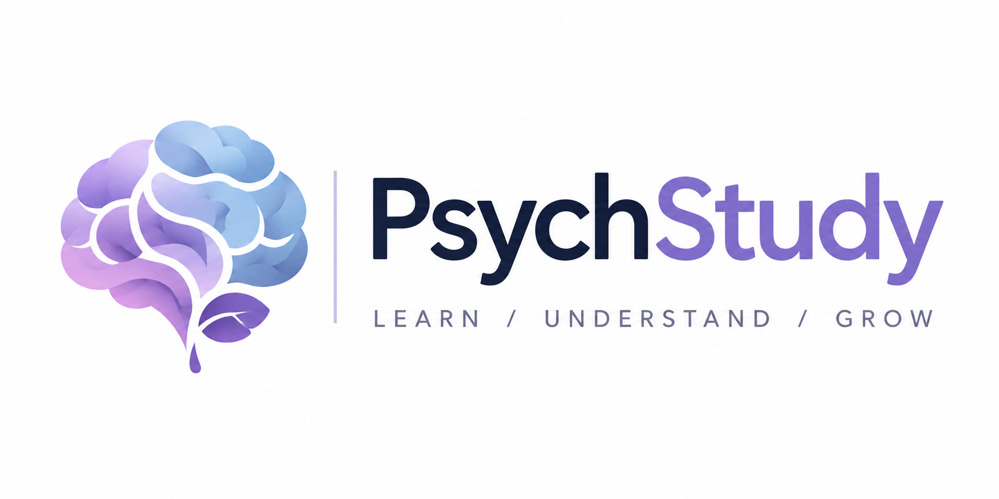

<div align="center">

  

  # PSYCHSTUDY · THE CLINICAL ATLAS
  ### A University-Grade Clinical Psychology Study Companion, Multi-Axial Diagnostic Framework & Revision Suite

  [](https://chillingbing648-sketch.github.io/PsychStudy/)
  [](https://github.com/chillingbing648-sketch/PsychStudy)
  [-10B981?style=for-the-badge)](https://github.com/chillingbing648-sketch/PsychStudy)
  [](https://github.com/chillingbing648-sketch/PsychStudy)

  <p align="center">
    <a href="https://chillingbing648-sketch.github.io/PsychStudy/"><strong>Explore the Live Clinical Atlas »</strong></a>
    <br />
    <a href="#-curriculum-topology--the-9-clinical-volumes">Curriculum Topology</a>
    ·
    <a href="#-six-clinical-learning-engines">Core Learning Engines</a>
    ·
    <a href="#-topological-concept-map-constellation">Constellation Graph</a>
    ·
    <a href="#-architectural-philosophy">Zero-Dependency Architecture</a>
  </p>

</div>

---

## 🏛️ Executive Summary

**PsychStudy ("The Clinical Atlas")** is an advanced, university-standard digital revision platform engineered specifically for psychological sciences undergraduates, clinical postgraduates, and psychiatric residents.

Traditional revision suites rely on isolated, static flashcards that foster rote memorization without contextual depth. **The Clinical Atlas** re-imagines psychopathology study as a **topological knowledge graph** aligned rigorously with the **American Psychiatric Association DSM-5-TR** and the **World Health Organization ICD-11**. 

Designed from the ground up as a zero-dependency vanilla single-page application (HTML5, CSS3, ES6+), it executes instantly in modern browsers and operates **100% offline via local file storage**, preserving uncompromising performance, privacy, and clinical focus.

> **Lead Architect & Author:** Harsh Dubey  
> **Diagnostic Alignment:** APA DSM-5-TR (2022) & WHO ICD-11 (2023)  
> **Standard:** University Undergraduate & Postgraduate Clinical Standard  

---

## 🔬 Six Clinical Learning Engines

<table>
  <tr>
    <td width="50%" valign="top">
      <h3>1. 📖 The 3-Column Academic Reader</h3>
      <p>A distraction-free, 12-section standardized clinical reader engineered with Newsreader and Fraunces typography for deep absorption.</p>
      <ul>
        <li><strong>§1–§3:</strong> Operationalized Criteria & Interactive Checklists</li>
        <li><strong>§4–§6:</strong> Prevalence, Biopsychosocial Tri-Panel & Neurobiology</li>
        <li><strong>§7–§9:</strong> Differential Diagnosis Matrices & Cultural Idioms</li>
        <li><strong>§10–§12:</strong> Case Vignettes, Examination Hub & APA-7 Refs</li>
        <li><strong>Dual Modes:</strong> Deep Comprehensive, Quick Criteria, and Exam Outline.</li>
      </ul>
    </td>
    <td width="50%" valign="top">
      <h3>2. 🗂️ Active Recall & Spaced Retrieval</h3>
      <p>A high-yield 3D index card workspace powered by an explainable, deterministic <strong>SM-2-lite algorithm</strong>.</p>
      <ul>
        <li><strong>121 Curated Clinical Cards:</strong> Spanning all 43 curriculum chapters.</li>
        <li><strong>Explainable Interval Scheduling:</strong> <code>Again (&lt;10m)</code>, <code>Hard (1d)</code>, <code>Good (3d)</code>, <code>Easy (6d)</code>.</li>
        <li><strong>Tactile Ergonomics:</strong> Full keyboard shortcut control (<code>Space</code> to flip, <code>1–4</code> to rate, <code>U</code> to undo).</li>
        <li><strong>Mobile Touch Optimization:</strong> Large 2×2 thumb rating grid with tactile color feedback.</li>
      </ul>
    </td>
  </tr>
  <tr>
    <td width="50%" valign="top">
      <h3>3. 🌌 Concept Map ("Constellation")</h3>
      <p>An interactive topological knowledge graph displaying comorbidity networks and differential boundaries.</p>
      <ul>
        <li><strong>43 Nodes across 9 Volume Nebulae:</strong> Visualizing spatial clusters.</li>
        <li><strong>39 Comorbidity &amp; Differential Vectors:</strong> Delicate hairline links that illuminate into radiant domain stains upon selection.</li>
        <li><strong>Progressive Disclosure:</strong> Eliminates clutter by highlighting anchor hubs and direct 1-hop neighbours on hover.</li>
        <li><strong>Clinical Inspector:</strong> Slide-up bottom sheet on mobile with instant chapter routing.</li>
      </ul>
    </td>
    <td width="50%" valign="top">
      <h3>4. ⚡ Diagnostic Assessment &amp; Quiz Suite</h3>
      <p>A rigorous evaluation engine combining canonical cloze retrieval and case vignette differential diagnosis.</p>
      <ul>
        <li><strong>1-Click Launchpad Presets:</strong> <code>Rapid 10</code>, <code>Standard 20</code>, <code>Timed Exam (15m)</code>, and <code>Weak Spots</code>.</li>
        <li><strong>Section A (Cloze):</strong> Precision DSM/ICD criterion input with normalized alias grading and examiner clue drawers.</li>
        <li><strong>Section B (Differential MCQs):</strong> Case analysis with instantaneous rationale and rule-in / rule-out justifications.</li>
        <li><strong>Persistent HUD:</strong> Sticky question jump navigation bar.</li>
      </ul>
    </td>
  </tr>
  <tr>
    <td width="50%" valign="top">
      <h3>5. 🎓 University Examination Suite</h3>
      <p>Formal university exam simulator aligned with the official Psychology of Adjustment curriculum syllabus.</p>
      <ul>
        <li><strong>Standardized Papers A &amp; B:</strong> 30 marks each with section timings.</li>
        <li><strong>Question Bank:</strong> 16 long-answer prompts with comprehensive model answers, marking rubrics, and diagnostic distinctions.</li>
        <li><strong>Live Writing Coach:</strong> Real-time word-count monitor, interval countdown timer, and self-rubric evaluation.</li>
        <li><strong>Print Ready:</strong> Formatted for standard university A4 printouts.</li>
      </ul>
    </td>
    <td width="50%" valign="top">
      <h3>6. 🧠 Interactive Neuroanatomy Atlas</h3>
      <p>Functional neuroanatomical plate illustrating neural circuits and cortico-limbic alterations in psychopathology.</p>
      <ul>
        <li><strong>6 Anatomical Divisions:</strong> Frontal, Temporal, Parietal, Occipital, Cerebellar, and Limbic Networks.</li>
        <li><strong>Pathological Correlates:</strong> Cortico-striatal dysregulation, amygdalo-hippocampal overdrive, and HPA axis hyperactivation.</li>
        <li><strong>Bilingual Cross-Referencing:</strong> Interlinks directly with the 3-Column Reader (§6 Neurobiology).</li>
      </ul>
    </td>
  </tr>
</table>

---

## 🌌 Topological Concept Map ("Constellation")

Constellation provides a macro-level cognitive overview of mental illness. Rather than categorizing disorders into isolated buckets, it visualizes the **transdiagnostic continuum**, symptom overlap, and differential boundaries between diagnoses:

```
                  [ VOL II: ANXIETY & TRAUMA ]
                     GAD <══════════════> Panic Disorder
                      ║                           ║
         High Comorbidity (60%+)         Autonomic Cascade
                      ║                           ║
                      ▼                           ▼
            Major Depression <═════════> Phobic Disorders
                      ▲                           ▲
                      ║                           ║
        Unipolar / Bipolar Shift         Exposure / ERP
                      ║                           ║
                      ▼                           ▼
                 Bipolar I & II            CBT Modalities
            [ VOL III: MOOD DISORDERS ]  [ VOL VII: THERAPIES ]
```

### Decluttered Celestial Visual Design
- **Selective Labeling:** Only major diagnostic anchors (e.g., Major Depression, Schizophrenia, CBT, GAD, Anorexia) display text tags by default to eliminate visual collision.
- **Ethereal Hairline Edges:** 39 differential and comorbidity vectors render as subtle dashed connections that ignite with radiant bioluminescent domain stains when selected.
- **Volume Domain Filters:** 1-tap filter pills (`All`, `Vol I`, ..., `Vol IX`) isolate individual diagnostic domains with smooth zoom and pan controls.
- **Responsive Drawer:** Operates as a sticky side inspector on widescreen monitors and transforms into a slide-up bottom sheet on mobile screens.

---

## 📚 Curriculum Topology · The 9 Clinical Volumes

The curriculum incorporates **43 comprehensively researched chapters** mapped across **9 Domain Stains**:

| Volume | Domain Name | Palette Stain | Key Diagnostic Chapters Covered | Standards Covered |
| :---: | :--- | :---: | :--- | :---: |
| **I** | **Foundations of Abnormality** | `teal` (`#0D9488`) | Historical Models, Four Ds, Biological & Psychological Models, Stigma | DSM-5-TR §I |
| **II** | **Anxiety & Trauma Disorders** | `sky` (`#0284C7`) | GAD, Panic Disorder, Agoraphobia, Specific Phobias, OCD, PTSD | F40–F43 · 6B00 |
| **III** | **Mood & Affective Disorders** | `violet` (`#7C3AED`) | MDD, Persistent Depressive (Dysthymia), Bipolar I & II, Cyclothymia, SAD, Suicide Risk | F30–F39 · 6A60 |
| **IV** | **Eating & Body Image** | `rose` (`#E11D48`) | Anorexia Nervosa, Bulimia Nervosa, Binge-Eating Disorder | F50 · 6B80 |
| **V** | **Personality Disorders** | `purple` (`#9333EA`) | Cluster A (Eccentric), Cluster B (Borderline, Antisocial), Cluster C (Anxious) | F60 · 6D10 |
| **VI** | **Psychotic Spectrum** | `blue` (`#2563EB`) | Schizophrenia (Positive & Negative), Schizoaffective, Delusional Disorder | F20–F29 · 6A20 |
| **VII** | **Clinical Therapies** | `emerald` (`#10B981`) | CBT, REBT, Systematic Desensitization, Psychodynamic, Person-Centered, Biomedical | Evidence-Based |
| **VIII** | **Culture & Health Context** | `amber` (`#D97706`) | Cultural Formulation, India/South Asian Clinical Lens, Gendered Help-Seeking | APA CFI |
| **IX** | **Stress, Adjustment & Coping** | `forest` (`#059669`) | Selye's GAS, Lazarus Cognitive Appraisal, Defense Mechanisms, Coping Strategies | Blueprint C & D |

---

## 🎨 Dual Clinical Design System

The application operates on an uncompromising, hospital-grade visual architecture:

```
┌────────────────────────────────────────────────────────────────────────┐
│  LUMINOUS LIVING PALETTE (Day Mode)                                   │
│  Canvas: #F8FAFC (Porcelain) · Cards: #FFFFFF · Accents: #4338CA       │
├────────────────────────────────────────────────────────────────────────┤
│  IMAGING SUITE (Night Workstation Mode)                                │
│  Canvas: #090D16 (Nocturnal Slate) · Cards: #131A2B · Neon: #818CF8    │
└────────────────────────────────────────────────────────────────────────┘
```

### Typography Hierarchy
- **Editorial Display:** `Fraunces` (Headings, Chapter Titles, Major Diagnoses)
- **Academic Prose:** `Newsreader` (Prose Flow, Diagnostic Criteria, Vignettes)
- **System Interface:** `Instrument Sans` (Navigation, Buttons, Flashcard Controls)
- **Clinical Data & Metrics:** `JetBrains Mono` (DSM/ICD Codes, Stats, Timers, Word Counts)

---

## 📱 Mobile-First Responsive Ergonomics

PsychStudy is engineered to deliver an uncompromising desktop workstation experience while seamlessly adapting to handheld mobile screens:

- **Single-Column Academic Flow:** Automatically collapses the 3-column study layout into an uninterrupted, readable single column on displays `<= 860px`.
- **Touch-Friendly Recall Grid:** Flashcard confidence buttons transform into a high-touch 2×2 button layout with large tap areas and visual press feedback.
- **Thumb Navigation Dock:** A fixed bottom navigation dock with safe-area padding (`env(safe-area-inset-bottom)`) grants 1-tap switching between Dashboard, Study, Flashcards, Quiz, and Notes.
- **Anti-Zoom Guardrails:** Form inputs use minimum 16px font sizing to prevent unwanted automatic viewport zooming in mobile WebKit/Safari.

---

## ⚙️ Architectural Philosophy & Code Quality

```
Zero Dependencies · Zero Build Bundlers · 100% Native Web Standards
```

PsychStudy operates strictly on standard web primitives:
- **Zero npm runtime dependencies:** No React, Next.js, Vue, or Webpack dependencies. Runs directly off disk via double-clicking `index.html`.
- **ESM & Vanilla Data Modules:** 17 validated data modules (`data/*.js`) verified by an automated integrity validator (`tools/validate-data.mjs`).
- **Explainable, Deterministic Intelligence:** Mastery scores, spaced repetition intervals, and curriculum recommendations use transparent mathematical algorithms rather than black-box APIs.
- **Local Persistence First:** Notes, criteria checklists, review history, and quiz attempts persist automatically in browser `localStorage`.

---

## 🚀 Getting Started & Local Installation

### Clone & Launch
```bash
# 1. Clone the repository
git clone https://github.com/chillingbing648-sketch/PsychStudy.git

# 2. Enter directory
cd PsychStudy

# 3. Open directly in your favourite browser (No server needed!)
# On macOS:
open index.html

# On Windows:
start index.html

# On Linux:
xdg-open index.html
```

### Automated Clinical Data Validation
To verify data schema, PDF syllabus coverage, and diagnostic consistency:

```bash
node tools/validate-data.mjs
```

```
=======================================================
   The Clinical Atlas — Data Integrity Validator
=======================================================
  ✔ Verified 47 APA-7 references registered.
  ✔ Found 43 total chapters loaded across 9 volumes.
  ✔ Verified 121 active recall cards across 39 decks.
  ✔ 60 Quiz items verified (25 canonical cloze, 35 MCQs).
  ✔ PDF Cloze Blueprint: 25 of 25 items represented (100%).
  ✔ 6 brain anatomical divisions defined.
  ✔ Daily Clinical Facts: 42 verified.
=======================================================
Errors: 0 · Warnings: 0 · [PASSED]
```

---

## 📖 Citation & Academic Attribution

If you utilize PsychStudy for academic study, curriculum preparation, or examination revision, please cite:

```bibtex
@misc{dubey2026psychstudy,
  author       = {Harsh Dubey},
  title        = {PsychStudy: The Clinical Atlas of the Mind},
  year         = {2026},
  publisher    = {GitHub},
  howpublished = {\url{https://github.com/chillingbing648-sketch/PsychStudy}},
  note         = {Undergraduate Psychology Standard Aligned with DSM-5-TR and ICD-11}
}
```

---

## ⚖️ Academic Notice & Peer Disclaimer

**PsychStudy ("The Clinical Atlas")** is an independent, non-commercial university revision and psychological sciences study environment. It is engineered strictly for educational, scientific, and examination revision purposes. It does not provide medical advice, psychiatric diagnosis, psychotherapeutic intervention, or acute crisis services.

If you or someone you know is experiencing acute emotional distress or psychiatric crisis, please contact verified emergency helplines:
- **India (Tele-MANAS):** Call `14416` or `1800-891-4416` (24/7 Free Clinical Support)
- **International Resources:** Connect with [Befrienders Worldwide](https://www.befrienders.org/) or [Find A Helpline](https://findahelpline.com/)

---

<div align="center">
  <sub>Designed, engineered, and curated with academic rigor by <strong>Harsh Dubey</strong>.</sub><br>
  <sub>PsychStudy · The Clinical Atlas © 2026 · All Rights Reserved.</sub>
</div>
